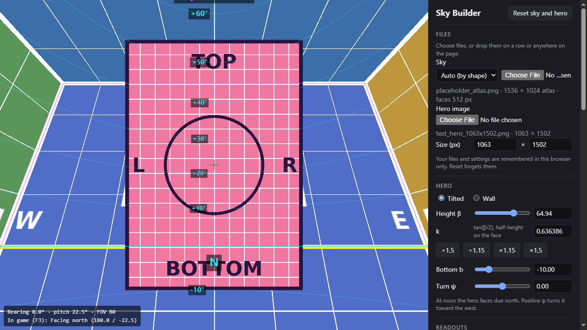
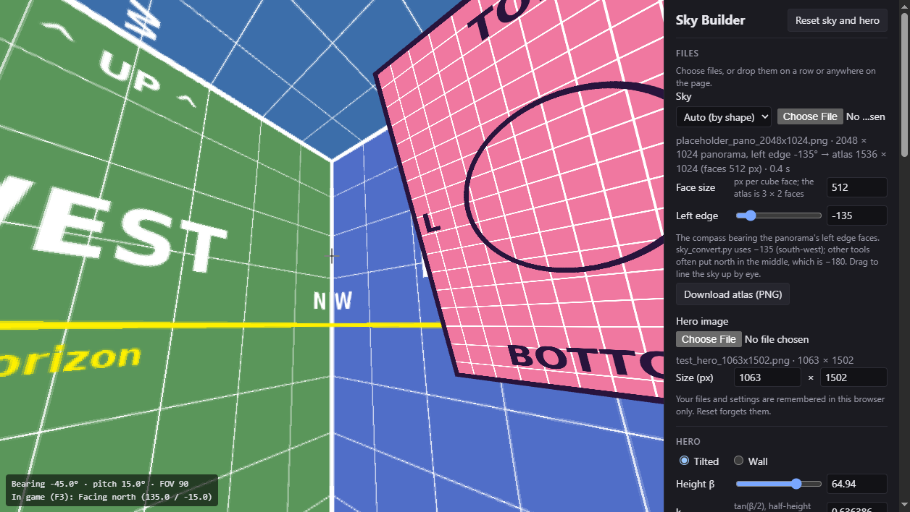
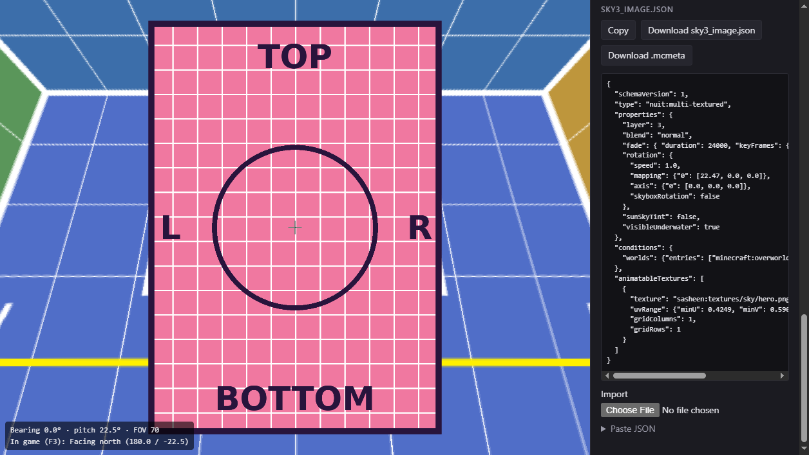

# Sky Builder

Place an image (the "hero") in a Minecraft sky made with the [Nuit](https://github.com/FlashyReese/nuit) mod,
see it live in 3D, and export the `sky3_image.json` that Nuit reads. No more editing numbers, reloading the
game and checking.



**Use it at <https://0xsasheen.github.io/sky-builder/>.** Everything runs in your browser; your images never leave
your computer.

## What it does

- **Shows your sky** as the cube Nuit draws, with drag-to-look. Load a sky atlas, or a panorama, which it
  converts for you.
- **Places the hero** with a few controls: its size, the height of its bottom edge, and its compass direction.
  *Tilted* mode keeps it facing you like a billboard; *wall* mode stands it upright on the north wall.
- **Warns you** when the image would spill off its cube face (Nuit would bend it over the edge) or tip over the
  zenith, and shows its angular size and edges.
- **Plays the day**: a time slider using vanilla's sun curve, so you can watch the hero cross the sky as it will in game.
- **Exports** `sky3_image.json` and `hero.png.mcmeta` exactly as Nuit 26.2 expects them, and **imports** an existing
  `sky3_image.json` so you can keep editing it.
- **Remembers** your files and settings in your browser until you press *Reset*.

## Quick start

1. **Sky.** Drop your sky onto the page. It can be an atlas (a 3 × 2 grid of cube faces, the layout
   `nuit:square-textured` uses) or a 2:1 equirectangular panorama. A panorama is converted in the browser:
   use **Download atlas (PNG)** to keep the atlas for your pack. If the converted sky comes out turned, drag
   **Left edge** until it lines up.
2. **Hero.** Drop your hero image. PNG transparency is kept.
3. **Place it.** Set **Height β** (or use the × and ÷ buttons), **Bottom b** (the elevation of its bottom edge) and
   **Turn ψ** (positive turns it west). **Look at hero** points the camera at it.
4. **Check it.** Move the time slider or press ▶. Fix anything shown in red; you can still export, after a confirmation.
5. **Name it.** Set **Texture** to where the image will be in your pack, such as `mypack:textures/sky/hero.png`.
6. **Export.** Download `sky3_image.json` and the `.mcmeta` file.



## Putting it in your pack

```
assets/
  nuit/sky/
    sky1_night.json        your night layer (nuit:square-textured)
    sky2_day.json          your day layer
    sky3_image.json        from Sky Builder
  <namespace>/textures/sky/
    hero.png               your hero image
    hero.png.mcmeta        from Sky Builder: smooth filtering and clamped edges
```

- **The hero turns with the sky** only if every sky layer's `rotation` matches the hero's: `"speed": 1.0`,
  `"axis": {"0": [0.0, 0.0, 0.0]}` and `"skyboxRotation": false`. Only `mapping` differs between layers.
- **Layers draw in `layer` order**, so layer 3 puts the hero over sky layers 1 and 2.
- Press **F3 + T** in game to reload resource packs.



## What it assumes

Minecraft Java 26.2 with Nuit for 26.2, the vanilla day cycle (no datapacks that change time), and no shader packs.
The preview follows Nuit's own geometry, rotation order, texture filtering and blending, checked against its
source and in game. The details are in [`docs/PLAN.md`](docs/PLAN.md).

## Converting panoramas offline

[`reference/sky_convert.py`](reference/sky_convert.py) converts between atlases and panoramas in both directions.
It needs Python with numpy and Pillow. The site's panorama converter uses the same convention, and matches the
script's output to within 1 per colour channel.

## Development

```
npm ci            # install
npm run dev       # dev server at http://localhost:5173/sky-builder/
npx vitest        # tests
npm run build     # production build into dist/
```

- [`docs/BRIEF.md`](docs/BRIEF.md) is the specification, and [`docs/PLAN.md`](docs/PLAN.md) records the design
  and how each detail was checked.
- The maths is in `src/math.ts` (pure functions, tested); `src/json.ts` writes and reads the exact JSON;
  `src/scene.ts` is the Three.js preview.
- Every push to `main` is tested, built and published to GitHub Pages by
  [`.github/workflows/deploy.yml`](.github/workflows/deploy.yml).

## Credits

- [Nuit](https://github.com/FlashyReese/nuit) by FlashyReese, the sky mod this tool targets.
- Built with [Three.js](https://threejs.org/) and [Vite](https://vite.dev/).
- Not affiliated with Mojang, Microsoft or the Nuit project.

## Licence

[MIT](LICENSE)
